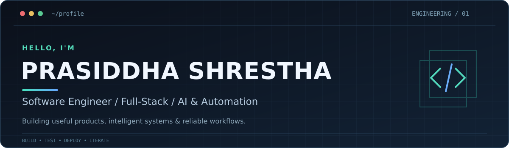

  
    
  
  
  <!-- Add verified LinkedIn and portfolio URLs here once confirmed. -->

### `> whoami`

I'm **Prasiddha**, a software engineer with experience building **full-stack applications, backend APIs, AI-powered tools, and workflow automation**. I care about turning complex requirements into practical products: from user interfaces and service architecture to retrieval pipelines, testing, and deployment.

- **Build:** React, TypeScript, Python, C# / ASP.NET Core, Django
- **Engineer:** REST APIs, SQL databases, authentication, unit and integration testing
- **Deploy:** Docker, Azure, CI/CD, Git-based workflows
- **Explore:** LLM applications, RAG, vector search, and useful developer tooling

### Recent projects:

- **CLI Ticket Manager:** A tool where you can add, view, filter, and resolve mock IT support tickets. Stores tickets in a local JSON file or SQLite database so data persists even after you close the terminal.
- **SLA Countdown & Escalation Visualizer:**  A single-page dashboard (using a tool like Airtable Interfaces, Notion, or a simple Streamlit/React app) that tracks open tickets against a timer. Turns ticket rows bright yellow or red as they approach their Service Level Agreement (SLA) deadline, and auto-escalates high-priority issues to a "Manager" view.
- **Game Theory & Strategic Decision-Making:** Developed a Python-based decision model using payoff matrices, best-response analysis, and Nash equilibrium to evaluate competitive pricing strategies and identify optimal decisions under varying market conditions.

### `> engineering.log`

| Area | Experience |
| :--- | :--- |
| **AI applications** | Developed document-retrieval and LLM application workflows involving preprocessing, embeddings, semantic search, REST APIs, and evaluation. |
| **Full-stack products** | Built interactive application features and frontend components with Python, Java, HTML/CSS, React and TypeScript, integrating user experiences with backend services. |
| **Backend systems** | Worked with ASP.NET Core, Django, SQL Server, PostgreSQL, REST APIs, authentication, and automated testing. |
| **Automation** | Built Python-based reconciliation automation and rule-based exception detection for financial operations. |

### `> featured.builds`

**Featured work is being curated.** The most substantial projects will appear here with source code, a screenshot or demo, implementation highlights, and clear setup instructions.

<!-- Example project card format; replace once the repo and demo have been verified:
| Project | What I built | Stack | Explore |
| :--- | :--- | :--- | :--- |
| Project name | Specific technical problem and outcome | Python · Docker | [Code](ACTUAL_REPO_URL) |
-->

### `> tech.stack`

**Languages & frontend**

    

**Backend & data**

    

**Cloud, developer tools & AI**

    

### `> current.workbench`

Ideas and work in progress — **not yet presented as completed projects**:
- **Interactive game:** Exploring a small game focused on clean mechanics and a polished experience.

### `> connect`

I'm interested in opportunities across **software engineering, full-stack development, AI-powered applications, backend systems, and automation**.

**Email:** [prasiddha.shrestha.09@gmail.com](mailto:prasiddha.shrestha.09@gmail.com) · **Projects:** [GitHub repositories](https://github.com/Prasiddhashrest?tab=repositories)

Build thoughtfully. Test deliberately. Keep improving.
