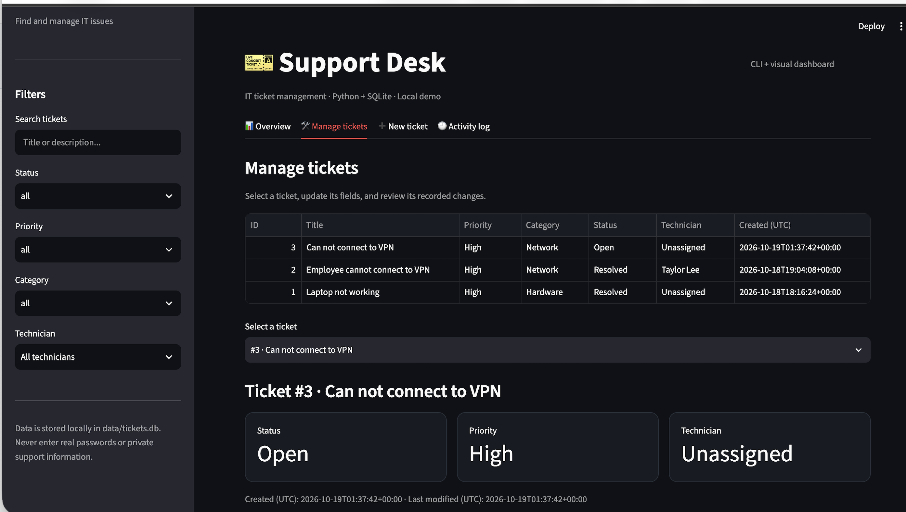

  
    
  
  
  <!-- Add verified LinkedIn and portfolio URLs here once confirmed. -->

### `> whoami`

I'm **Prasiddha**, a developer with experience building **full-stack applications, backend APIs, AI-powered tools, and workflow automation**. I care about turning complex requirements into practical products: from user interfaces and service architecture to retrieval pipelines, testing, and deployment. I’ve worked with Startups and completed internships across different fields. I’m always looking to learn more, explore new technologies, and take on projects that push me to build smart scaleable solutions.

Beyond tech, I’m especially interested in quantitative economics, financial systems, modeling behavior and the way data, incentives,technology shape our decisions.
When I’m not building or analyzing something, you’ll usually find me going for a run, watching soccer, playing games , or occasionally trying to make one! 🎮

### `> engineering.log`

| Area | Experience |
| :--- | :--- |
| **AI applications** | Developed document-retrieval and LLM application workflows involving preprocessing, embeddings, semantic search, REST APIs, and evaluation. |
| **Full-stack products** | Built interactive application features and frontend components with Python, Java, HTML/CSS, React and TypeScript, integrating user experiences with backend services. |
| **Backend systems** | Worked with ASP.NET Core, Django, SQL Server, PostgreSQL, REST APIs, authentication, and automated testing. |
| **Automation** | Built Python-based reconciliation automation and rule-based exception detection for financial operations. |

### `> Recent Technical projects:`

1. ### CLI Ticket Manager:
    A full end-to-end IT support ticket management system where you can add, view, filter, and resolve mock IT support tickets. Stores tickets in a local JSON file or SQLite database so data persists even after you close the terminal. [View Repository →](https://github.com/Prasiddhashrest/cli-ticket-manager)

2. ### Pokémon Character Guess Game:
   Built an interactive Pokémon guessing game with dynamic character selection, game-state management, scoring logic, responsive feedback, and API-backed character data, creating a replayable frontend experience centered on fast user interaction and clean state transitions. [View Repository →](https://github.com/Prasiddhashrest/pokemon-character-guess-game)

3. ### LinkVault:
   Built a link-management application with structured CRUD workflows for saving, organizing, searching, and managing bookmarked resources, with an emphasis on persistent data handling, intuitive filtering, and a clean productivity-focused user experience. [View Repository →](https://github.com/Prasiddhashrest/linkvault)

### Other Projects 
- **SLA Countdown & Escalation Visualizer:**  A single-page dashboard (using a tool like Airtable Interfaces, Notion, or a simple Streamlit/React app) that tracks open tickets against a timer. Turns ticket rows bright yellow or red as they approach their Service Level Agreement (SLA) deadline, and auto-escalates high-priority issues to a "Manager" view.
- **Game Theory & Strategic Decision-Making:** Developed a Python-based decision model using payoff matrices, best-response analysis, and Nash equilibrium to evaluate competitive pricing strategies and identify optimal decisions under varying market conditions.

<!-- Example project card format; replace once the repo and demo have been verified:
| Project | What I built | Stack | Explore |
| :--- | :--- | :--- | :--- |
| Project name | Specific technical problem and outcome | Python · Docker | [Code](ACTUAL_REPO_URL) |
-->

### `> tech.stack`

**Languages & frontend**

**Backend & data**

    

### > dev.tools

**IDEs & Code Editors**

**Development & API Tools**

**Cloud, developer tools & AI**

    

## Build Activity

### `> current.workbench`

### 🎫 CLI Ticket Manager

A lightweight IT support ticket management system built with **Python + SQLite**, combining a command-line workflow with a visual dashboard for managing tickets, filtering issues, tracking activity, and reviewing workload trends.

**Highlights**
- Create, update, assign, resolve, and search support tickets
- Filter by status, priority, category, and technician
- SQLite-backed local persistence
- Visual dashboard with ticket metrics and workload trends
- Activity history for ticket changes
- CLI-first workflow with a complementary dashboard

[View Repository →](https://github.com/Prasiddhashrest/cli-ticket-manager)

### `> connect`

I'm interested in opportunities across **Software engineering, Product development, AI Engineering, Full-stack development, front-end and backend systems, and automation**.

**Email:** [prasiddha.shrestha.09@gmail.com](mailto:prasiddha.shrestha.09@gmail.com) · **Projects:** [GitHub repositories](https://github.com/Prasiddhashrest?tab=repositories)

Build thoughtfully. Test deliberately. Keep improving.
 
